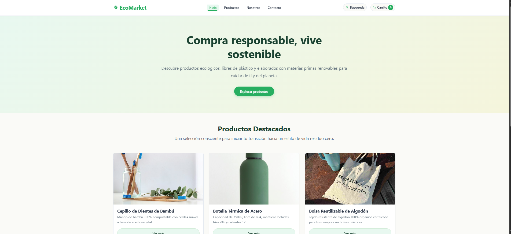
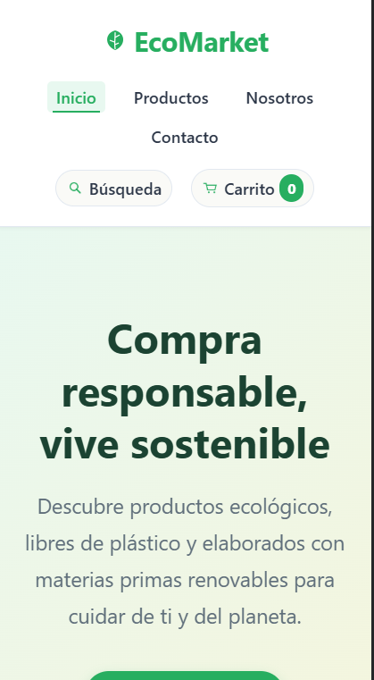
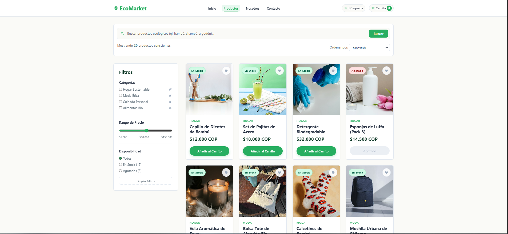
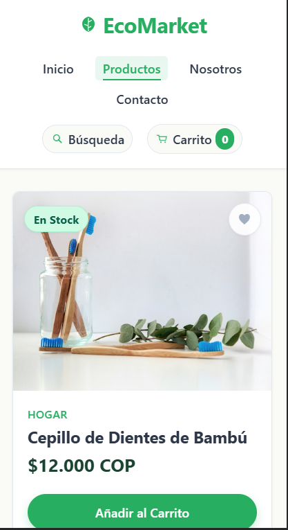
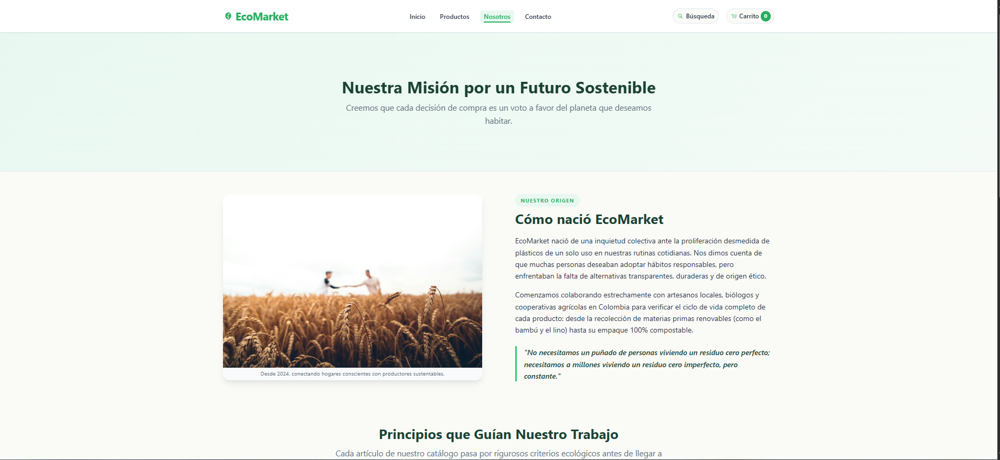
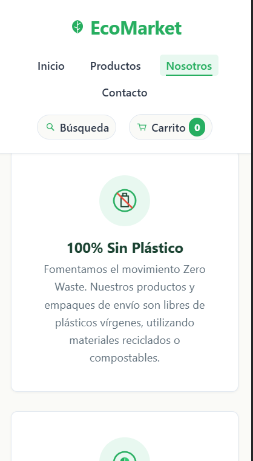
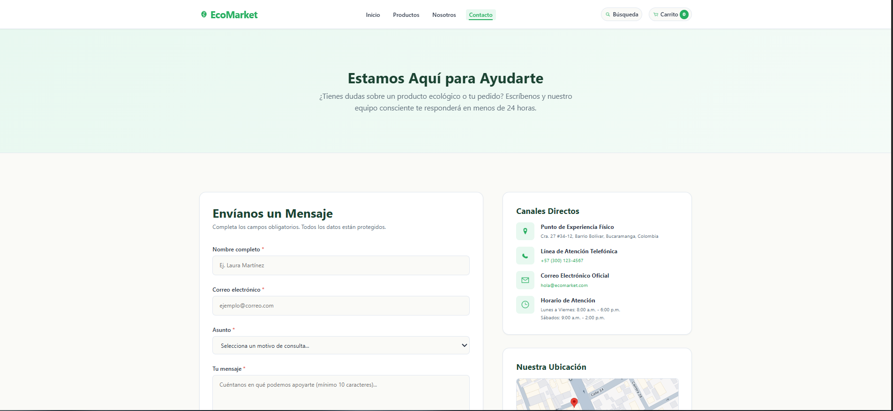
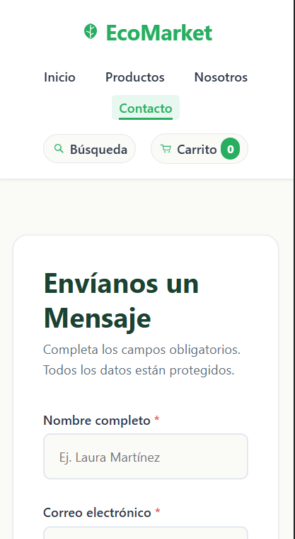

#  EcoMarket - Tienda en Línea Sostenible

 **Plataforma web de comercio electrónico dedicada a productos ecológicos, reutilizables y sustentables.**  
 Diseñada bajo la filosofía de consumo consciente, arquitectura **Mobile First** y desarrollada exclusivamente con **HTML5 Semántico y CSS3 Puro (0% JavaScript, sin frameworks)**.

---

##  Tabla de Contenidos
1. [Descripción del Proyecto](#-descripción-del-proyecto)
2. [Vistas Principales y Funcionalidades](#-vistas-principales-y-funcionalidades)
3. [Especificaciones Técnicas](#-especificaciones-técnicas)
4. [Estructura de Archivos](#-estructura-de-archivos)
5. [Instrucciones de Visualización Local](#-instrucciones-de-visualización-local)
6. [Galería de Capturas de Pantalla](#-galería-de-capturas-de-pantalla)
7. [Guía de Despliegue](#-guía-de-despliegue)


---

##  Descripción del Proyecto

**EcoMarket** surge como una respuesta a la creciente necesidad de un consumo responsable y transparente frente a la proliferación de plásticos de un solo uso. La plataforma ofrece una experiencia de compra limpia, accesible e intuitiva que conecta a consumidores conscientes con productores y artesanos sustentables.

---

##  Vistas Principales y Funcionalidades

### 1. Página de Inicio (`index.html`)
- **Header:** Logotipo con icono ecológico, menú de navegación semántico y accesos rápidos a búsqueda y carrito de compras.
- **Banner Hero:** Mensaje inspirador (*"Compra responsable, vive sostenible"*), subtítulo y botón CTA (*"Explorar productos"*) con micro-interacción de brillo suave.
- **Productos Destacados:** Grid responsivo de 6 tarjetas con efecto **hover lift** que eleva la tarjeta suavemente mediante `transform: translateY(-8px)` y sombra multicapa difusa.
- **Footer Institucional:** Enlaces a políticas, canales de atención al cliente y redes sociales.

### 2. Catálogo de Productos (`views/productos.html`)
- **Barra Superior:** Buscador visual con icono y selector de ordenamiento por relevancia y precio.
- **Sidebar de Filtros Sticky:** Barra lateral izquierda que acompaña el desplazamiento del usuario (`position: sticky`), con filtros por:
  - Categorías (*Hogar Sustentable*, *Moda Ética*, *Cuidado Personal*, *Alimentos Bio*).
  - Control deslizante de rango de precios (`<input type="range">`) con etiquetas legibles.
  - Disponibilidad (*En Stock*, *Agotados*).
- **Grid de 20 Productos:** Matriz responsiva adaptativa:
  - **Desktop (≥ 1024px):** 4 columnas.
  - **Tablet (640px - 1023px):** 2 columnas.
  - **Móvil (< 640px):** 1 columna.
- **Card de Producto:** Imagen con zoom suave al cursor, categoría, título, precio, badge de stock y botón de favoritos con activación visual mediante pseudo-clases CSS (`:active` y `:target`).
- **Paginación Visual:** Navegación semántica con control activo y deshabilitado.

### 3. Sobre Nosotros (`views/sobre-nosotros.html`)
- **Historia de Origen:** Layout flexible en **Flexbox** que combina narrativa fundacional e imagen ilustrativa.
- **Principios Ecológicos:** Grid de 4 pilares sostenibles con iconos representativos (*100% Sin Plástico*, *Comercio Justo y Local*, *Huella de Carbono Neutra* y *Cruelty Free y Botánico*).
- **Carrusel CSS de Testimonios:** Tarjetas de testimonios con **CSS Scroll-Snap** horizontal, calificación en estrellas y efecto dinámico de elevación, rotación del avatar y expansión al pasar el mouse.

### 4. Página de Contacto (`views/contacto.html`)
- **Formulario Inteligente:** Campos para Nombre, Email, Asunto y Mensaje con validación nativa HTML5 y retroalimentación visual inmediata en CSS puro:
  - Bordes rojos y fondos de alerta para campos vacíos/inválidos (`:invalid`).
  - Bordes verdes y mensajes de confirmación para datos válidos (`:valid`).
- **Canales Directos:** Horarios, líneas de atención y ubicación presencial.
- **Mapa Estático:** Imagen cartográfica estilizada con diseño minimalista.
- **Redes Sociales:** Botones interactivos con animación de escala elástica (`transform: scale(1.08)`).

---

##  Especificaciones Técnicas

| Requerimiento | Implementación |
|---|---|
| **Estructura** | HTML5 Semántico (`<header>`, `<nav>`, `<main>`, `<section>`, `<article>`, `<aside>`, `<figure>`, `<footer>`) |
| **Estilos** | CSS3 Modular con Variables Nativas (Design Tokens) |
| **Interactividad** | Pseudo-clases puras (`:hover`, `:active`, `:focus-within`, `:target`, `:valid`, `:invalid`) |
| **Layouts** | CSS Grid y Flexbox bidimensional |
| **JavaScript** | **0% (Estrictamente sin scripts)** |
| **Librerías / Frameworks** | **Ninguna (CSS puro)** |
| **Enfoque** | Mobile First con Media Queries progresivas |

---

##  Estructura de Archivos

```
EcoMarket/
├── css/
│   ├── main.css            # Design tokens, reset, tipografía y utilidades
│   ├── layout.css          # Header sticky, Footer, contenedores y sistemas Grid
│   ├── components.css      # Tarjetas, botones, inputs, badges y sidebar sticky
│   └── animations.css      # Keyframes, transiciones y efectos hover
├── img/
│   ├── products/           # 22 fotografías de productos ecológicos (500x500)
│   ├── icons/              # 16 iconos PNG transparentes institucionales
│   └── hero/               # Banners, mapa, historia y retratos de clientes
├── views/
│   ├── productos.html      # Catálogo con 20 productos y filtros
│   ├── sobre-nosotros.html # Misión, principios y carrusel de testimonios
│   └── contacto.html       # Formulario inteligente con validación pura CSS
├── index.html              # Página de Inicio (Home)
└── README.md               # Documentación técnica del proyecto
```

---

##  Instrucciones de Visualización Local

### Requisitos previos
Solo necesitas un navegador web moderno (Google Chrome, Mozilla Firefox, Microsoft Edge o Safari).

### Pasos para ejecutar localmente
1. **Clonar el repositorio:**
   ```bash
   git clone https://github.com/mcalderonserpa/EcoMarket-HTML_CSS-CampusLands
   cd EcoMarket-HTML_CSS-CampusLands
   ```

2. **Abrir en el navegador:**
   - **Opción A (Directa):** Haz doble clic en el archivo `index.html`.
   - **Opción B (Recomendada con VS Code):** Abre la carpeta en Visual Studio Code, haz clic derecho sobre `index.html` y selecciona **"Open with Live Server"**.

---

##  Galería de Capturas de Pantalla

### 1. Página de Inicio (Home)
| Versión Escritorio | Versión Móvil |
|:---:|:---:|
|  |  |

### 2. Catálogo de Productos
| Versión Escritorio (Grid 4 Col + Sidebar) | Versión Móvil (Grid 1 Col) |
|:---:|:---:|
|  |  |

### 3. Sobre Nosotros
| Historia y Principios (Escritorio) | Carrusel de Testimonios (Móvil) |
|:---:|:---:|
|  |  |

### 4. Contacto
| Formulario con Validación CSS (Escritorio) | Canales y Redes (Móvil) |
|:---:|:---:|
|  |  |
